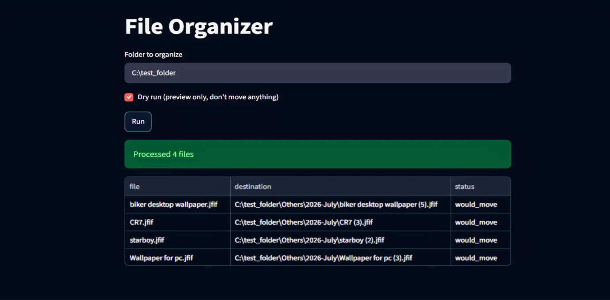

# File Organizer Automation 🗂️

A Python automation tool that sorts Downloads and Desktop folders by file type
and date, with collision-safe moving, CLI configuration, and a Streamlit UI.

**Live demo:** https://rania-file-organizer.streamlit.app/

## Screenshot

## What It Does

- Scans Downloads and Desktop folders
- Sorts files into folders by type (Images, Documents, Videos, Music)
- Organizes by date modified (Year-Month)
- Creates destination folders automatically if they don't exist
- Never overwrites files with matching names — automatically renames
  colliding files (`file.txt` → `file (1).txt` → `file (2).txt`)
- Skips its own output folders on rerun instead of re-processing them

## How to Run

Command line:

###  Organize real Downloads/Desktop
`python file_organizer_automation.py`

### Organize a specific folder
`python file_organizer_automation.py --folder "path/to/folder`

### Preview changes without moving anything
`python file_organizer_automation.py --dry-run`

Web UI:

`streamlit run streamlit_app.py`

## Modules Used

- `pathlib` — building and finding folder paths, checking for filename collisions
- `shutil` — moving files
- `datetime` — organizing files by modification date
- `argparse` — CLI configuration (`--folder`, `--dry-run`)
- `logging` — structured run output
- `streamlit` — web UI

## Testing

Covered by a pytest suite (`test_file_organizer_automation.py`) — category
lookup and end-to-end file-moving behavior, verified with pytest's `tmp_path`
fixture for isolated test runs.

`python -m pytest`

## Status

✅ v1 complete.

- Collision-safe file moving (no silent overwrites)
- No unnecessary re-processing of the tool's own output folders
- CLI configuration (`--folder`, `--dry-run`)
- Structured logging
- Type hints and docstrings on all functions
- Test coverage (pytest)
- Streamlit UI, deployed

Next: smart/ML-based file categorization (v2).